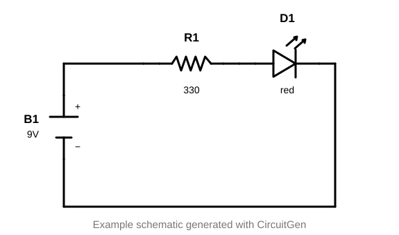
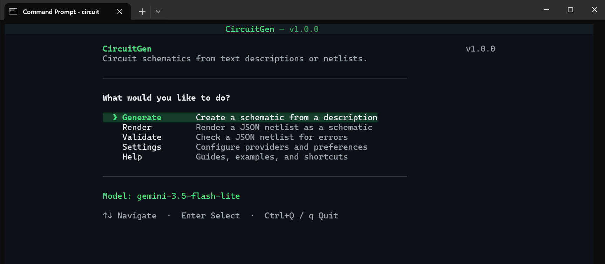

<p align="center">
  <picture>
    <source media="(prefers-color-scheme: dark)" srcset="assets/banner-dark.png">
    <source media="(prefers-color-scheme: light)" srcset="assets/banner-light.png">
    
  </picture>
  <br>
  Generate circuit schematics from text descriptions or netlists.
</p>

<p align="center">
  <a href="https://github.com/git-ishaan-kumar/circuitgen"></a>
  <a href="https://pypi.org/project/circuitgen/"></a>
</p>

<p align="center">
  <a href="https://pypi.org/project/circuitgen/"></a>
  <a href="https://pypi.org/project/circuitgen/"></a>
  <a href="LICENSE"></a>
</p>


## Overview

CircuitGen is a Python library and CLI for generating circuit schematics from text descriptions or netlists.

<p align="center">
  <picture>
    <source media="(prefers-color-scheme: dark)" srcset="assets/example-dark.svg">
    <source media="(prefers-color-scheme: light)" srcset="assets/example-light.svg">
    
  </picture>
</p>


## Features

- **Natural Language Generation**
  > Generate schematics from written circuit descriptions using your preferred AI provider.
- **Automatic Layout and Routing**
  > Place components and route wires automatically from a netlist.
- **Interactive CLI**
  > Generate, render, and validate circuits directly from your terminal.
- **Offline Rendering**
  > Render existing netlists without an API key or internet connection.
- **Flexible Export**
  > Save schematics as SVG, PNG, or PDF with customizable appearance.


## Quickstart

### Python library

```sh
pip install circuitgen
```

### CLI

```sh
pip install circuitgen
circuit
```

<p><sub>If the CLI fails to start or behaves unexpectedly, run <code>python -m circuit doctor</code> to check your setup.</sub></p>


## Python example

```python
from circuitgen import generate

generate(
    "A 9 V battery connected in series with a 470 Ω resistor and a red LED.",
    provider="gemini",
    model="gemini-3.5-flash-lite",
    output="circuit.svg"
)
```

<p><sub>Requires a configured API key.</sub></p>
<p><sub>AI output can be wrong or invalid. Choose a model suited to your task and review generated circuits.</sub></p>


## Command-line interface

<p align="center">
  
</p>


## License

Released under the [MIT License](LICENSE).
